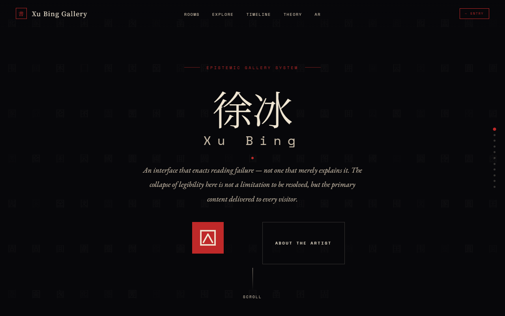

# Xu Bing: Epistemic Gallery

An interactive exhibition prototype about **reading, ambiguity, and intentional friction**.

**[Try the live prototype](https://tommhci.github.io/Xu-Bing-Gallery/)** · **[Read the design case study](CASE_STUDY.md)**



**Design question:** How can an interface preserve the productive uncertainty of reading Xu Bing's work without making basic navigation feel broken?

**What informed the redesign:** Three in-person moderated think-aloud sessions (34–38 minutes each) produced 31 observation notes across four themes, and an external UX designer's heuristic evaluation independently rated back-navigation as its highest-severity issue. Those findings drove the revised navigation and recovery paths. **No post-revision validation is claimed.**

**Explore:** The ambiguous entry, glyph-classification interaction, and persistent wayfinding. Spatial AR is a concept extension, not a deployed feature.

*Independent educational project. Not affiliated with or endorsed by Xu Bing Studio or any museum.*

---

## Why This Exists

Most digital galleries are built for retrieval. They help visitors find an artist, open an image, read metadata, and move on.

That model breaks down for Xu Bing.

His work is not only something to look at. It is a system for interrupting recognition: characters that appear readable but cannot be read, English letters rebuilt as Chinese calligraphy, pictographic systems that promise universality while exposing the limits of shared interpretation.

If a website simply explains that Xu Bing works with unreadability, the interface has already softened the experience. The visitor receives the idea as information before encountering it as a problem.

This project starts from a different premise:

> A digital exhibition should not only describe the artwork. It should reproduce the conditions of attention the artwork requires.

## The Core Design Problem

The project is built around one distinction:

**Parasitic friction** is confusion that blocks access.
It makes visitors feel lost, unsure, or mechanically stuck.

**Load-bearing friction** is confusion that carries meaning.
It makes visitors experience the instability of reading itself.

The design goal is not to make the gallery frictionless. It is to remove the wrong friction and preserve the right friction.

## What The Interface Does

The gallery is a single-page interpretive environment, not a conventional archive.

It includes:

- A deliberately ambiguous entry interaction that withholds immediate resolution.
- Four interpretive rooms organized around different failures of legibility.
- A persistent navigation layer so visitors can stay oriented while the content remains difficult.
- A Glyph Deconstruction Engine that forces classification before revealing the available categories.
- A theory layer connecting reading failure, pseudo-legibility, semiotic borders, and cognitive rupture.
- A provenance layer that separates artwork references from interpretive framing.
- A visual AR concept panel for installation-scale extensions.

The important move is separation: navigation should become clearer; the artwork's conceptual difficulty should not.

## Design Principles

### 1. Do Not Explain Too Early

If the interface explains the trick before the visitor feels it, the artwork becomes a caption. The entry glyph and glyph-classification tool delay explanation long enough for uncertainty to become part of the experience.

### 2. Make Interaction Self-Evidencing

The strongest interaction in the prototype is not a text panel. It is the Glyph Engine, because the visitor has to act before the system reveals what kind of sign they were looking at. The interaction teaches the argument by making the visitor perform it.

### 3. Keep Orientation Separate From Meaning

Visitors should not be confused about where they are, what is clickable, or how to recover from navigation mistakes. Those are interface failures. The conceptual confusion should happen inside the act of reading, not inside the mechanics of using the site.

### 4. Treat Trust As Interface Architecture

Dense interpretation needs source clarity. The prototype uses authorship tags, provenance, timeline context, and theory links so visitors can distinguish artwork metadata, curatorial interpretation, and conceptual argument.

## Research Behind The Design

The project was shaped by three moderated think-aloud sessions with English-dominant participants who did not have prior exposure to Xu Bing or Chinese writing systems.

The strongest finding was structural: participants repeatedly treated the visually dominant glyph as the entry point, clicked it, received no response, and lost confidence in the interface. They also lost orientation after nonlinear navigation and browser-back behavior.

Those failures led to a sharper design rule:

> Access should be repaired without neutralizing unreadability.

The revised prototype strengthens orientation through visible navigation, section tracking, minimap behavior, breadcrumbs, and scoped back-navigation. At the same time, it preserves the two intentional friction moments: the delayed entry glyph and the unlabeled glyph-classification choices.

The evidence is directional. It supports the problem diagnosis and design rationale; it should not be overstated as broad proof of effectiveness across a general museum audience.

## What Is Real In This Build

Implemented:

- Single-page gallery experience
- Room navigation and scroll-based section tracking
- Minimap navigation
- Browser back-navigation guard
- Entry interaction
- Glyph classification engine
- Square Word interactive demo
- Theory reveal sequence
- Artwork provenance table
- Responsive layout
- Vite build and GitHub Pages deployment

Concept only:

- Hardware-based AR
- Gaze-responsive audio
- Deep-zoom character inspection
- Physical gallery installation layer

## Stack

HTML, CSS, and vanilla JavaScript, built with Vite.

The project uses modular JavaScript for interaction behavior and plain HTML content for maintainability. This was a deliberate choice: the important parts of the concept depend on actual timing, clicking, scrolling, guessing, recovering, and reorienting. A static mockup could show the composition, but it could not test whether the friction feels accidental or designed.

## Local Development

```bash
npm install
npm run dev
npm run build
npm run preview
```

The local dev server runs at `http://localhost:5173` by default.

## Deployment

GitHub Pages deployment is handled by `.github/workflows/deploy.yml` on pushes to `main`. The workflow installs dependencies, runs `npm run build`, uploads the generated `dist/` directory, and deploys that artifact through GitHub Pages.

The canonical source entry is `index.html`; Vite builds it with the `/Xu-Bing-Gallery/` base path configured in `vite.config.js`.

## Project Structure

```text
xu-bing-gallery/
├── index.html
├── package.json
├── vite.config.js
└── src/
    ├── css/
    │   ├── tokens.css
    │   ├── base.css
    │   ├── components.css
    │   └── sections.css
    └── js/
        ├── data.js
        ├── main.js
        └── modules/
            ├── loader.js
            ├── cursor.js
            ├── pseudo-bg.js
            ├── entry-rupture.js
            ├── navigation.js
            ├── you-are-here.js
            ├── navigation-guard.js
            ├── minimap.js
            ├── reveal.js
            ├── char-matrix.js
            ├── square-word.js
            ├── glyph-quiz.js
            ├── theory-reveal.js
            └── ar-grid.js
```

## References Checked

- Xu Bing Studio, [artwork index and artist materials](https://www.xubing.com/en/work), checked July 23, 2026.
- GitHub Docs, [custom GitHub Pages workflows](https://docs.github.com/en/pages/getting-started-with-github-pages/using-custom-workflows-with-github-pages), checked July 23, 2026.

## Project history and license

Commit history spans two accounts: work from May to July 2026 is authored under an earlier account (`leafeng318`), later work under `tommhci`.

The code and the original written content of this repository are released under the MIT license (see `LICENSE`). Referenced artworks, quotations, and third-party sources remain the property of their respective rightsholders and are not covered by that license.
